# SV3DS — Stardew Valley for the Nintendo 3DS

An unofficial reimplementation of **Stardew Valley** for the Nintendo 3DS family (New 3DS and the original 3DS and 2DS). This repository has its releases (`sdv3ds.3dsx` and `sdv3ds.cia`) and the guide; the game checks it for updates.

**No Stardew Valley files are here, and none are included in the releases.** You need your own copy of the game (PC: Steam, GOG...): the console converts the files you copy from it. Stardew Valley is © ConcernedApe; this project isn't affiliated with or endorsed by ConcernedApe.

**It's a beta.** It's played and tested on a New 3DS, and players run it on the original 3DS and 2DS too (it can be slower there). Found a problem? [Open an issue](https://github.com/gonzalo-araoz/SV3DS-releases/issues) saying what happened and, if you can, with a photo of the screen.

**Download:** [latest release](https://github.com/gonzalo-araoz/SV3DS-releases/releases/latest) · *[Guía en español](#sv3ds--stardew-valley-para-nintendo-3ds)*

<p align="center">
  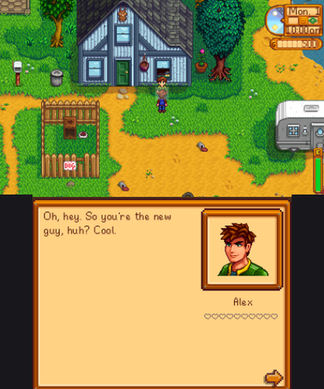
  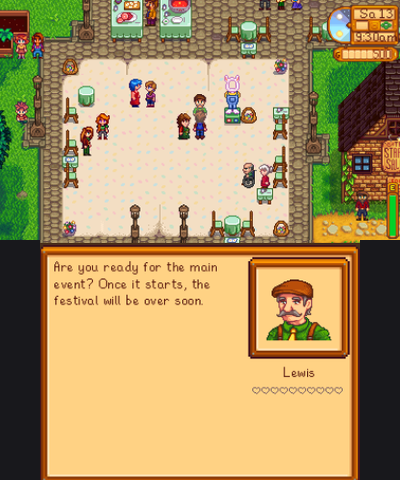
  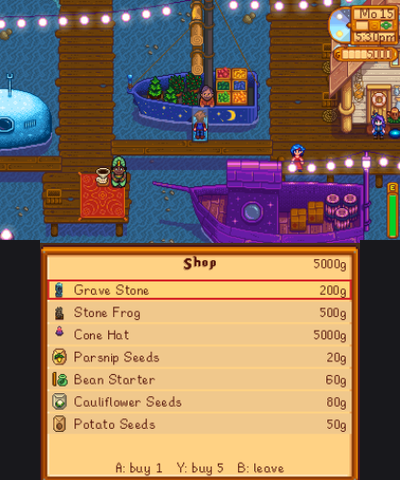
</p>

**Install it from the console, without taking out the SD card:** in FBI, *Remote Install* → *Scan QR Code*, and point the camera at this code (always the latest `.cia`). Or *Manually Enter URLs* with `https://github.com/gonzalo-araoz/SV3DS-releases/releases/latest/download/sdv3ds.cia`. You still copy your game's `Content` folder to the SD card once (step 2 of [Installing](#installing-the-console-converts-the-game)).


### Contents

- [Installing (the console converts the game)](#installing-the-console-converts-the-game)
- [Adding it to the HOME Menu](#adding-it-to-the-home-menu)
- [Updates](#updates)
- [Sound](#sound)
- [Controls](#controls)
- [What's in it](#whats-in-it)
- [Cheats](#cheats)

## Installing (the console converts the game)

The computer is only used to copy files to the SD card: the console does the conversion. You need a 3DS with
custom firmware and the Homebrew Launcher, an SD card with about **1.2 GB** free, and the game files from your
Stardew Valley installation.

### Step 1 — Put the app on the SD card

Copy `sdv3ds.3dsx` to the `3ds` folder of the SD card:

```
SD card
└── 3ds/
    └── sdv3ds.3dsx
```

### Step 2 — Copy your game's `Content` folder

Find where Stardew Valley is installed on your computer:

- **Steam:** in your library, right click *Stardew Valley* → *Manage* → *Browse local files*.
- **GOG Galaxy:** *More* → *Manage installation* → *Show folder*.

It needs the game's current version, **1.6**. On Steam that's the *Default Public Version* (Properties → Betas), the one it's tested with. `legacy_1.5.6` doesn't work.

Inside there's a folder called **`Content`**. On the SD card, create a folder named `sdv3ds` inside `3ds`, and copy
the whole `Content` folder into it:

```
SD card
└── 3ds/
    ├── sdv3ds.3dsx
    └── sdv3ds/               ← you create this one
        └── Content/          ← the game's Content folder (Data, Maps, Characters, ...)
```

The app makes everything else in `3ds/sdv3ds` by itself when it converts (the `data`, `maps`, `tex` and `audio`
folders, and later your saves): you don't create anything else.

**Shortcut:** the app also finds `Content` at the root of the SD card (`Content/`) or in `Stardew Valley/Content/`,
so you can just drop the folder at the root without creating anything. The converted data still goes to
`3ds/sdv3ds`.

**Faster: copy it as a zip.** `Content` has thousands of small files, and copying those to an SD card is slow. Zip
the folder on your computer (Windows: right click `Content` → *Send to* → *Compressed (zipped) folder*; macOS:
right click → *Compress*) and copy the single `Content.zip` instead, to `3ds/sdv3ds/Content.zip` or the root of the
SD card. The app reads the game's files straight from the zip; you don't unzip it.

If you open the app without it, it tells you what's missing. If it finds something close (a folder named a little differently, Content inside another Content, a 1.5 copy, an unfinished copy), it says what it found and where:

<p align="center">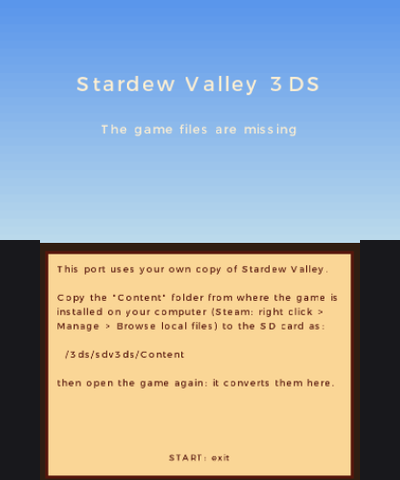</p>

### Step 3 — Open the app and convert

Open **sdv3ds** from the Homebrew Launcher. The first time, it saves your console's sound firmware (see
[Sound](#sound): nothing to do), finds your game files and asks two things:

- **Language** (◀ ▶): English, Spanish or Russian (it starts with your console's language).
- **Sounds and music** (Y): include them or not. Without them the game runs silently.

Press **A** to start.

<p align="center">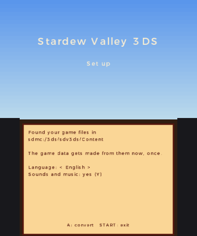</p>

### Step 4 — Wait for the conversion

The console makes the game's data from your files, with a progress bar. It takes a few minutes; keep the console on
and plugged in. The sounds are left for later: once the game starts they're converted **in the background while you
play**, with a small "Sounds N%" bar in the corner, and they come on by themselves when it's done. If you quit before
that, it picks up where it left off next time (from `Content.zip` the bar starts from 0 again, but what's done stays).

<p align="center">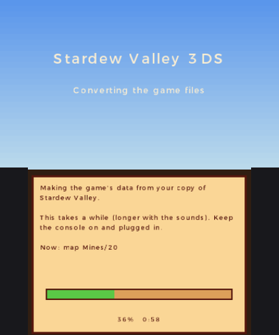</p>

If the conversion fails, the app leaves `3ds/sdv3ds/setup_mem.log` on the SD card: attach it to an
[issue](https://github.com/gonzalo-araoz/SV3DS-releases/issues) with a photo of the message.

### Step 5 — Play

When it's done, the game starts. Next time it goes straight to the title screen.

<p align="center">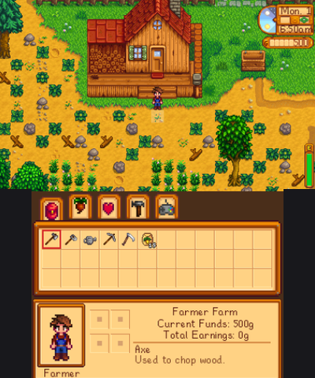</p>

You can delete `3ds/sdv3ds/Content` afterwards to free space. If you keep it, a future version of the app that
needs the data in a new format converts it again by itself.


## Adding it to the HOME Menu

The `.3dsx` opens from the Homebrew Launcher. To have SV3DS as an icon on the HOME Menu, next to your games, install
the **`sdv3ds.cia`** from the [releases page](https://github.com/gonzalo-araoz/SV3DS-releases/releases/latest) with **FBI** (it comes
with the usual custom firmware setup from [3ds.hacks.guide](https://3ds.hacks.guide/finalizing-setup); if you don't
have it, it's on the Homebrew Launcher's list in Universal-Updater).

1. Copy `sdv3ds.cia` anywhere on the SD card, for example a `cias` folder:

   ```
   SD card
   ├── cias/
   │   └── sdv3ds.cia
   └── 3ds/
       └── sdv3ds/        ← the game's data stays here, as before
   ```

2. On the console, open **FBI** (from the HOME Menu or the Homebrew Launcher).
3. Go to **SD** → **cias** → **sdv3ds.cia** and choose **Install CIA**. Confirm with A.
4. Close FBI with HOME. The **SV3DS** icon is now on the HOME Menu (at the end of the list): open it like any game.

Notes:
- It's the same app: it uses the same `3ds/sdv3ds` folder, so your data, sounds and saves are shared with the
  `.3dsx`. The first time it converts the game exactly as in [Installing](#installing-the-console-converts-the-game)
  if the data isn't there yet.
- To update, install the new `.cia` over the old one the same way (nothing is lost). To remove it: System Settings →
  Data Management → Nintendo 3DS → Software, or FBI → Titles.
- You can delete `sdv3ds.cia` from the SD card after installing it.


## Updates

When the console is online, the title screen checks
[SV3DS-releases](https://github.com/gonzalo-araoz/SV3DS-releases) (a public repository with only the `.3dsx` and
`.cia`) for a newer version. **A** downloads and installs it: the installed `.cia` installs over itself and starts
again; the `.3dsx` is replaced on the SD card, and you open it again from the Homebrew Launcher. Saves and converted
data are kept (the data is converted again by itself when a version needs it). The version is shown in the corner of
the title screen.

**The HOME Menu icon and banner.** The published `.cia` has none of the game's pictures (a plain icon, an empty
banner). Installed, the title screen offers to put **your** game's on it: the chicken as the icon and the logo as the
banner, taken from your converted files on the console. That version is downloaded again and installed with them, and
every later update keeps them. Nothing of the game leaves your console.


## Sound

The 3DS plays sound through its DSP, which needs its firmware in `sd:/3ds/dspfirm.cdc`. **The app makes that file
by itself** the first time it opens: it reads the firmware from your console's own Home Menu (the same thing
[DSP1](https://github.com/zoogie/DSP1) does), so there's no extra step. If it couldn't (the game tells you
"No sound" when it starts), run DSP1 once. In an emulator (Azahar, Citra) any file with that name is enough,
because the DSP is emulated.


## Controls

<p align="center">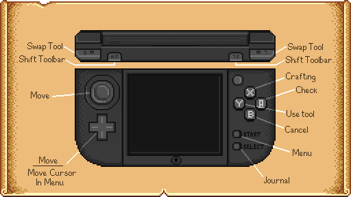</p>
<p align="center"><i>Controls map by <a href="https://github.com/CrisPH7">CrisPH7</a> — thank you!</i></p>

| Button | What it does |
|---|---|
| D-Pad / Circle Pad | walk in 8 directions (hold B to walk slowly; can be swapped in Options) |
| Y | use the tool, weapon or rod; plant; eat. Hold Y to charge upgraded hoes and watering cans |
| A | action: talk, give gifts, doors, harvest, pick up, ship, sleep, counters, ladders, hook a fish. Hold A to keep harvesting or sowing along a row |
| L / R | pick the toolbar item (the first row of the backpack); in the menu, go through its tabs |
| ZL / ZR (New 3DS) | shift the toolbar to the backpack's next row |
| X | open the crafting menu, then go through its tabs; in the mines with a weapon, its special move (sword: block, dagger: quick stabs, club: slam) |
| Touch screen | tabs; in the backpack, touch two slots to swap them (hold Y when you touch where it goes to put down just one, X for half), a ring and then its slot to wear it; an item and then the trash can (right of the tabs) to throw it away, or your portrait to drop it on the ground |
| SELECT | the journal (quests, special orders, achievements) |
| START | options (quit from there) and skip events |

**Fishing:** hold Y facing water to charge the cast and let go, A when the "!" shows up, then hold Y (or A, or touch
the screen) to raise the green bar.

**Battery:** Options → Frame rate → 30 uses less battery.

<p align="center">
  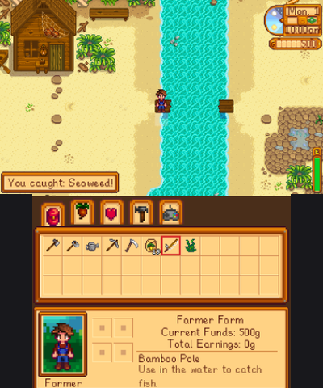
  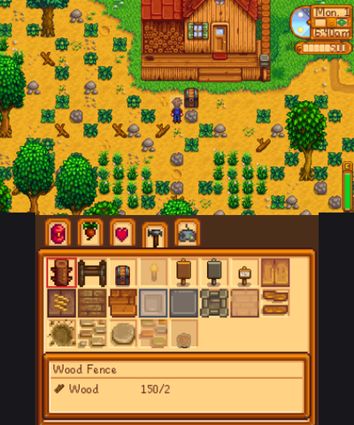
  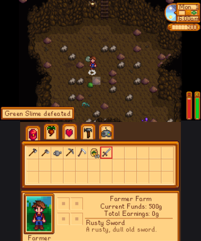
</p>


## What's in it

**The game's moments**
- The opening: Grandpa's last words and his envelope, the Joja office years later, his letter in the drawer; then the
  arrival at the bus stop, Robin showing you the farm and Mayor Lewis's welcome (START skips the opening).
- Willy's invitation on the 2nd and his scene at the beach, where he gives you his old rod.
- Fishing as on PC: hold Y to fill the casting power bar ("MAX" at full), the bobber flies out as far as it reaches,
  the "!" and the rod shaking on a bite, "HIT!", and the catch flying out of the water to be held up over your head
  with its name in a bubble.
- The end of the day: the level ups, then the shipping summary over the night sky (farming, foraging, fishing, mining,
  other and total, each with its money dial counting up), the date scroll turning to the new day, "Saving..." and
  "Your progress has been saved."
- The little things: dialogue typing out letter by letter with its sound (A shows the whole page); what you pick up
  in the game's message boxes with the item's icon, stacked in the corner; damage numbers popping off monsters and
  off you; collapsing on the spot at 2am, out of energy or knocked out in the mines; a tool from Clint held up over
  your head.
- Tools as on PC: charging the hoe or the watering can holds it up, flashes in each level's color with the rising
  charge sound and outlines the tiles it will reach; the game's own effects for hoeing, watering, breaking stones,
  cutting weeds and harvesting.
- Every fish has its length (in inches, or centimeters in Spanish and Russian) and its quality: bigger fish come out silver or
  gold, and a perfect catch raises it one step (gold becomes iridium). Beating your best for a kind shows its length
  in blue.
- Weather as on PC: the game's rain drops splashing on the ground, its snow layer, and windy days in spring and fall
  with petals or leaves blowing past in gusts; the weather icon in the clock; the game's odds for each (snow on most
  winter days, sunny festivals).
- Artisan goods keep what they're made of, as on PC: Blueberry Wine, Cranberry Jelly, Pickled Potato, Catfish Roe
  and its Aged Roe, Poppy Honey (the closest flower in bloom; Wild Honey without one), Dried Apricots, Smoked Catfish
  (it keeps the fish's quality), with the game's prices from the ingredient and their icons in its color.
- The backpack starts with one row (12 slots), as in the game; Pierre sells the Large and Deluxe Packs. Its trash can
  throws things away and anything can be dropped on the ground; the shipping bin takes anything the game ships, even
  trash worth 0g.
- Marriage as in the game: the wedding in the town square with Mayor Lewis and the whole town, then your spouse lives
  with you and talks with the game's own lines for spouses (the weather, the season, how things are going; now and
  then a present). Robin's second house upgrade adds the nursery: your spouse may ask for a baby, born 14 days later
  and named by you; babies sleep in the crib, then crawl around the nursery and walk around the house.
- The skills, social and map tabs don't pause the game: look at them on the bottom screen while you play.
- Decorating from the bottom screen: inside the house a last tab shows the room from above; drag furniture with the
  stylus (green where it fits, red where it doesn't), drag in what's in the backpack, A turns it, Y puts it away.
- The social tab as the game's: faces, how you're related, hearts, this week's gifts and today's talk, those you know
  first.
- The map tab (between social and crafting, as in the game): the valley in the season's colors, your face where you
  are, the name of what you touch. L and R go through the menu tabs in order.
- Exhaustion as on PC: you can keep working into negative energy, slowly (no running, slower swings), with the
  game's warnings at 15 and 0, and pass out at -15; going to bed exhausted means half the energy the next morning.
- Tools at the game's pace (a swing takes as long as on PC, however fast you press), holding Y swings the farming
  tools again and again; the sword and the scythe slash with the game's own motion; furniture goes back into the
  backpack with Y (A turns it), the house's own bed and TV too (you wake up wherever the bed is; beds can be bought).
- Sounds as the game mixes them: each at its own volume, with its random pitch and volume variation (no two
  footsteps alike); footsteps by what you walk on (dirt with its dust puff, grass, snow in winter, stone, wood,
  bridges, the paths you lay), a soft thud indoors.
- Emotes: a heart for a loved gift and an angry face for a hated one, villagers who catch you in the trash (Linus
  smiles), the farmer's empty watering can and exhaustion; special items (the Rusty Key, the Skull Key) held up.

<p align="center">
  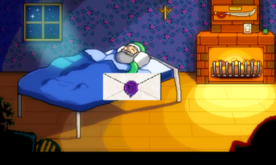
  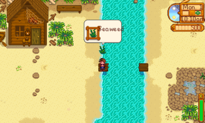
  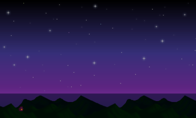
</p>

**Farm**
- Crops from `Data/Crops` with seasons, watering, regrowth, quality (silver, gold, iridium) by level and
  fertilizer; fruit trees, and oaks, maples and pines from their seeds; tool upgrades up to iridium with area charging.
- Fences that join their neighbours, gates that open and close with A, floors and paths that connect; crows and
  scarecrows; debris, trees and boulders.
- Crafting and machines from `Data/Machines`, chests and sprinklers.
- Coop, barn, silo, shed, fish pond, slime hutch, stable and their upgrades built by Robin; animals from Marnie that
  graze, produce better with friendship, can be milked and sheared; incubators.
- **Furniture**: the game's 600+ pieces (chairs, tables, couches, rugs, lamps, paintings and windows on the walls...),
  bought from Robin (a different selection every day) or won at festivals. Place with Y (seats face you), turn with
  A, pick up with the axe or pickaxe; A on a chair, bench or couch sits down.
- **Wallpaper and flooring** from Pierre (a few new ones every day): use them inside a room of the house and that
  room changes, as in the game. At night the house darkens and lamps, torches and fireplaces glow.
- House upgrade with a kitchen and 80 cooking recipes; TV with the weather, the fortune teller and the Queen of
  Sauce; greenhouse; the Wizard's obelisks; the horse; your pet.

**Town and villagers**
- 29 villagers with schedules, portrait dialogue, gifts and friendship; heart events played by our own
  interpreter of `Data/Events`; dating, the mermaid pendant, the wedding and your spouse at home.
- All 8 festivals (egg hunt, flower dance, luau soup, ice fishing, secret gift...), plus the 1.6 ones: the
  **Desert Festival** (Calico Eggs), **Trout Derby**, **SquidFest** and the **Night Market**.
- Mail, the calendar, help-wanted requests, **special orders** (including the randomized ones), the journal with the
  story quests, and **achievements**.
- The Community Center with all 31 bundles and their rewards, or the Joja route; the museum; the sewers and Krobus;
  the traveling cart; the trash cans.
- Shops of Pierre, Willy, Gus, Harvey, Joja, Clint, Robin, Marnie, Sandy, Marlon and the festivals. X switches to
  selling: each shop buys what it buys in the game (Pierre crops and artisan goods, Willy fish, Clint minerals and
  ores, Marnie animal products, Robin wood and stone, Marlon monster loot, weapons, rings and boots), at the game's prices.
- Tailoring at Emily's sewing machine and dyeing clothes; shirts and pants you wear.
- The **movie theater** once the Community Center is restored, with the season's film.

<p align="center">
  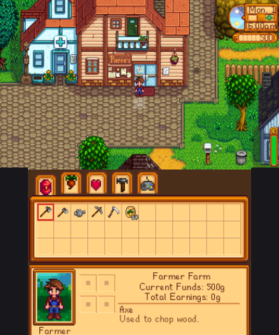
  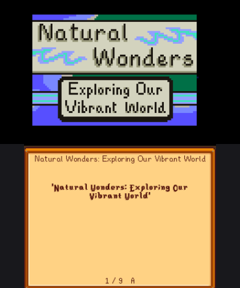
  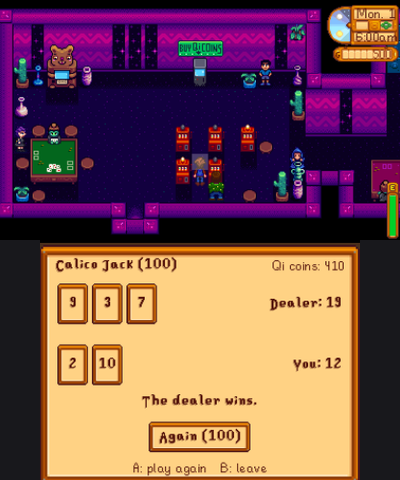
</p>

**Mines and combat**
- 120 mine levels with the game's layouts, ores, gems, geodes, elevator and treasure floors; the Skull Cavern.
- Monsters from `Data/Monsters` with their AI; rings, hats and boots.

**More**
- In English, Spanish or Russian, with the game's own translation. The port's own texts (menus, messages) in Russian
  are a first translation: corrections are welcome in the issues.
- Mr. Qi's casino: slots and Calico Jack, and the club's shop.
- **Mastery** (1.6): once every skill is at level 10, Grandpa's cave in the forest and its five masteries.
- The valley's bushes, with salmonberries and blackberries in their seasons.
- **Ginger Island**: the boat there, **golden walnuts** (walnut bushes, buried ones dug with the hoe, Leo's tree, the
  banana shrine, fishing) and the parrots that take them: Leo's opens the island's paths, another moves the turtle to the
  west. Crab pots; skills and professions with the game's experience curve.
- A character creator like the PC one, the PC-style menu on the bottom screen, the PC HUD on the top one, three
  save slots.

**Not there yet:** the other parrots of Ginger Island and what they build (the bridge, the farmhouse, the resort...), its other
walnuts, the volcano and its other places, the 1.6 wallpaper and flooring sets, the statues/anvil/mini-forge/mystic trees' effects, golden animal crackers, trinkets,
Mr. Qi's special orders and Walnut Room, the Desert Festival races and Marlon's challenges.


## Cheats

Optional, in Options → Cheats:

| Cheat | What it does |
|---|---|
| +10,000 gold | adds 10,000 gold |
| Refill energy & health | fills both |
| Infinite energy | tools cost no energy (until turned off) |
| Freeze time | the clock stops (until turned off) |
| Fast walk | 60% faster (until turned off) |
| Grow crops here | every crop on the current map is ready to harvest |
| Water soil here | waters all tilled soil on the current map |
| Resource pack | wood, stone, fiber, hardwood, coal and bars |
| All skills +1 level | one level up in every skill (with the level-up and profession screens) |
| Max friendship | 10 hearts with every villager |

## Support

If you'd like to support the time I put into this: [PayPal](https://paypal.me/gonzaaraoz). It doesn't unlock anything; the port is and stays free.

---

# SV3DS — Stardew Valley para Nintendo 3DS

Una reimplementación no oficial de **Stardew Valley** para la familia Nintendo 3DS (New 3DS y las 3DS y 2DS originales). Este repositorio tiene sus versiones (`sdv3ds.3dsx` y `sdv3ds.cia`) y la guía; el juego lo consulta para actualizarse.

**Acá no hay archivos de Stardew Valley, y las versiones no traen ninguno.** Necesitás tu propia copia del juego (PC: Steam, GOG...): la consola convierte los archivos que copiás de ella. Stardew Valley es © ConcernedApe; este proyecto no está afiliado ni respaldado por ConcernedApe.

**Es una beta.** Se juega y se prueba en una New 3DS, y los jugadores también la usan en las 3DS y 2DS originales (ahí puede ir más lenta). ¿Encontraste un problema? [Abrí un issue](https://github.com/gonzalo-araoz/SV3DS-releases/issues) contando qué pasó y, si podés, con una foto de la pantalla.

**Descarga:** [última versión](https://github.com/gonzalo-araoz/SV3DS-releases/releases/latest)

<p align="center">
  
  
  
</p>

**Instalalo desde la consola, sin sacar la SD:** en FBI, *Remote Install* → *Scan QR Code*, y apuntá la cámara a este código (siempre el `.cia` más nuevo). O *Manually Enter URLs* con `https://github.com/gonzalo-araoz/SV3DS-releases/releases/latest/download/sdv3ds.cia`. Igual tenés que copiar una vez la carpeta `Content` del juego a la SD (paso 2 de [Instalación](#instalación-la-consola-convierte-el-juego)).


### Contenido

- [Instalación (la consola convierte el juego)](#instalación-la-consola-convierte-el-juego)
- [Agregarla al menú HOME](#agregarla-al-menú-home)
- [Actualizaciones](#actualizaciones)
- [Sonido](#sonido)
- [Controles](#controles)
- [Qué tiene](#qué-tiene)
- [Trucos](#trucos)

## Instalación (la consola convierte el juego)

La computadora solo se usa para copiar archivos a la SD: la conversión la hace la consola. Necesitás una 3DS con
custom firmware y el Homebrew Launcher, una SD con unos **1,2 GB** libres y los archivos de tu instalación de
Stardew Valley.

### Paso 1 — Copiá la app a la SD

Copiá `sdv3ds.3dsx` a la carpeta `3ds` de la SD:

```
SD
└── 3ds/
    └── sdv3ds.3dsx
```

### Paso 2 — Copiá la carpeta `Content` de tu juego

Buscá dónde está instalado Stardew Valley en tu computadora:

- **Steam:** en la biblioteca, clic derecho en *Stardew Valley* → *Administrar* → *Ver archivos locales*.
- **GOG Galaxy:** *Más* → *Administrar instalación* → *Mostrar carpeta*.

Hace falta la versión actual del juego, la **1.6**. En Steam es la *Default Public Version* (Propiedades → Betas), la que se usa para probarlo. `legacy_1.5.6` no funciona.

Adentro hay una carpeta llamada **`Content`**. En la SD, creá una carpeta llamada `sdv3ds` dentro de `3ds` y copiá
adentro la carpeta `Content` entera:

```
SD
└── 3ds/
    ├── sdv3ds.3dsx
    └── sdv3ds/               ← esta la creás vos
        └── Content/          ← la carpeta Content del juego (Data, Maps, Characters, ...)
```

Todo lo demás dentro de `3ds/sdv3ds` lo crea la app sola al convertir (las carpetas `data`, `maps`, `tex` y `audio`,
y después tus partidas): no tenés que crear nada más.

**Atajo:** la app también encuentra `Content` en la raíz de la SD (`Content/`) o en `Stardew Valley/Content/`, así
que podés copiar la carpeta directo en la raíz sin crear nada. Los datos convertidos igual van a `3ds/sdv3ds`.

**Más rápido: copiala como zip.** `Content` tiene miles de archivos chicos, y copiar eso a una SD es lento.
Comprimí la carpeta en la computadora (Windows: clic derecho en `Content` → *Enviar a* → *Carpeta comprimida
(en zip)*; macOS: clic derecho → *Comprimir*) y copiá el único archivo `Content.zip`, a `3ds/sdv3ds/Content.zip` o
a la raíz de la SD. La app lee los archivos del juego directamente del zip: no hace falta descomprimirlo.

Si abrís la app sin ella, te dice qué falta. Si encuentra algo parecido (una carpeta con otro nombre, Content dentro de otro Content, una copia de la 1.5, una copia sin terminar), te dice qué encontró y dónde:

<p align="center"></p>

### Paso 3 — Abrí la app y convertí

Abrí **sdv3ds** desde el Homebrew Launcher. La primera vez guarda el firmware de sonido de tu consola (ver
[Sonido](#sonido): no hay que hacer nada), encuentra los archivos del juego y te pregunta dos cosas:

- **Idioma** (◀ ▶): inglés, español o ruso (arranca con el idioma de tu consola).
- **Sonidos y música** (Y): incluirlos o no. Sin ellos el juego queda sin sonido.

Apretá **A** para empezar.

<p align="center"></p>

### Paso 4 — Esperá la conversión

La consola crea los datos del juego desde tus archivos, con una barra de progreso. Tarda unos minutos; dejá la consola
prendida y enchufada. Los sonidos quedan para después: cuando arranca el juego se convierten **en segundo plano mientras
jugás**, con una barrita "Sonidos N%" en la esquina, y se activan solos al terminar. Si salís antes, la próxima vez
sigue donde quedó (desde `Content.zip` la barra arranca de 0 otra vez, pero lo hecho no se pierde).

<p align="center"></p>

Si la conversión falla, la app deja `3ds/sdv3ds/setup_mem.log` en la SD: adjuntalo en un
[issue](https://github.com/gonzalo-araoz/SV3DS-releases/issues) con una foto del mensaje.

### Paso 5 — A jugar

Cuando termina, arranca el juego. Las próximas veces va directo a la pantalla de inicio.

<p align="center"></p>

Después podés borrar `3ds/sdv3ds/Content` para liberar espacio. Si la dejás, una versión futura de la app que
necesite los datos en otro formato los vuelve a convertir sola.


## Agregarla al menú HOME

El `.3dsx` se abre desde el Homebrew Launcher. Para tener SV3DS como un ícono en el menú HOME, junto a tus juegos,
instalá el **`sdv3ds.cia`** de la [página de releases](https://github.com/gonzalo-araoz/SV3DS-releases/releases/latest) con **FBI**
(viene con la instalación de custom firmware de [3ds.hacks.guide](https://3ds.hacks.guide/es_ES/finalizing-setup); si
no lo tenés, está en la lista de Universal-Updater).

1. Copiá `sdv3ds.cia` en cualquier lugar de la SD, por ejemplo en una carpeta `cias`:

   ```
   Tarjeta SD
   ├── cias/
   │   └── sdv3ds.cia
   └── 3ds/
       └── sdv3ds/        ← los datos del juego siguen acá, como antes
   ```

2. En la consola, abrí **FBI** (desde el menú HOME o el Homebrew Launcher).
3. Entrá a **SD** → **cias** → **sdv3ds.cia** y elegí **Install CIA**. Confirmá con A.
4. Cerrá FBI con HOME. El ícono de **SV3DS** ya está en el menú HOME (al final de la lista): abrilo como cualquier
   juego.

Notas:
- Es la misma app: usa la misma carpeta `3ds/sdv3ds`, así que los datos, los sonidos y las partidas se comparten con
  el `.3dsx`. Si los datos todavía no están, la primera vez convierte el juego igual que en
  [Instalación](#instalación-la-consola-convierte-el-juego).
- Para actualizar, instalá el `.cia` nuevo encima del viejo de la misma forma (no se pierde nada). Para borrarla:
  Configuración de la consola → Administración de datos → Nintendo 3DS → Programas, o FBI → Titles.
- Después de instalarlo podés borrar `sdv3ds.cia` de la SD.


## Actualizaciones

Con la consola conectada a internet, la pantalla de título se fija en
[SV3DS-releases](https://github.com/gonzalo-araoz/SV3DS-releases) (un repositorio público con solo el `.3dsx` y el
`.cia`) si hay una versión nueva. **A** la descarga e instala: el `.cia` instalado se instala encima y se vuelve a abrir;
el `.3dsx` se reemplaza en la SD y lo abrís de nuevo desde el Homebrew Launcher. Las partidas y los datos convertidos se
conservan (los datos se vuelven a convertir solos cuando una versión lo necesita). La versión se ve en la esquina de la
pantalla de título.

**El ícono y el banner del menú HOME.** El `.cia` publicado no trae ningún dibujo del juego (un ícono genérico y el
banner vacío). Instalado, la pantalla de título ofrece ponerle los de **tu** juego: la gallina de ícono y el logo de
banner, sacados de tus archivos convertidos en la consola. Esa versión se baja de nuevo y se instala con ellos, y las
actualizaciones siguientes los conservan. Nada del juego sale de tu consola.


## Sonido

La 3DS reproduce el sonido con su DSP, que necesita su firmware en `sd:/3ds/dspfirm.cdc`. **La app crea ese archivo
sola** la primera vez que se abre: lee el firmware del propio menú HOME de tu consola (lo mismo que hace
[DSP1](https://github.com/zoogie/DSP1)), así que no hay ningún paso extra. Si no pudo (el juego avisa "Sin sonido"
al empezar), corré DSP1 una vez. En un emulador (Azahar, Citra) alcanza con cualquier archivo con ese nombre, porque
el DSP se emula.


## Controles

<p align="center">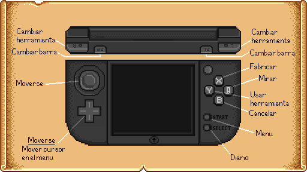</p>
<p align="center"><i>Mapa de controles hecho por <a href="https://github.com/CrisPH7">CrisPH7</a> — ¡gracias!</i></p>

| Botón | Qué hace |
|---|---|
| Cruceta / Circle Pad | moverse en 8 direcciones (B: caminar despacio; se puede invertir en Opciones) |
| Y | usar la herramienta, el arma o la caña; plantar; comer. Mantener Y carga la azada y la regadera mejoradas |
| A | acción: hablar, regalar, puertas, cosechar, juntar, enviar, dormir, mostradores, escaleras, enganchar el pez. Mantén A para seguir cosechando o sembrando a lo largo de la fila |
| L / R | elegir el objeto de la barra (la primera fila de la mochila); en el menú, recorrer las pestañas |
| ZL / ZR (New 3DS) | pasar la barra a la fila siguiente de la mochila |
| X | abrir la fabricación y después recorrer las pestañas; en la mina con un arma, su ataque especial (espada: bloquear, daga: estocadas rápidas, maza: golpe en el suelo) |
| Táctil | pestañas; en la mochila, toca dos espacios para cambiarlos (mantén Y al tocar dónde va para dejar uno solo, X para la mitad), y un anillo y después su espacio para ponértelo; un objeto y después el tacho (a la derecha de las pestañas) para tirarlo, o tu retrato para soltarlo en el suelo |
| SELECT | el diario (misiones, pedidos especiales, logros) |
| START | opciones (desde ahí se sale) y saltear eventos |

**Pesca:** mantén Y mirando el agua para cargar el lanzamiento y suéltalo, A cuando aparece el "!", y después mantén
Y (o A, o toca la pantalla) para subir la barra verde.

**Batería:** Opciones → Cuadros por segundo → 30 gasta menos batería.

<p align="center">
  
  
  
</p>


## Qué tiene

**Los momentos del juego**
- La introducción: las últimas palabras del abuelo y su sobre, la oficina de Joja años después, su carta en el cajón;
  después la llegada a la parada del autobús, Robin mostrándote la granja y la bienvenida del alcalde Lewis (START
  saltea la introducción).
- La carta de Willy el día 2 y su escena en la playa, donde te regala su caña vieja.
- La pesca como en PC: mantené Y para llenar la barra de fuerza del lanzamiento ("MAX" al máximo), el corcho vuela
  hasta donde llega, el "!" y la caña que tiembla cuando pica, "HIT!", y lo que pescaste sale volando del agua y lo
  levantás sobre la cabeza con su nombre en un globito.
- El fin del día: las subidas de nivel, después el resumen de envíos sobre el cielo de noche (agricultura,
  recolección, pesca, minería, otros y total, cada uno con su contador de dinero), el pergamino con la fecha que pasa
  al día nuevo, "Guardando..." y "Tu progreso se ha guardado."
- Los detalles: los diálogos se escriben letra por letra con su sonido (A muestra la página entera); lo que recogés
  aparece en los cartelitos del juego con el ícono del objeto, apilados en la esquina; los números de daño saltan de
  los monstruos y de vos; te desmayás en el lugar a las 2 de la mañana, sin energía o al caer en la mina; la
  herramienta que te da Clint la levantás sobre la cabeza.
- Las herramientas como en PC: al cargar la azada o la regadera el granjero la levanta, destella con el color de cada
  nivel y el sonido de carga, y se marcan las casillas que va a alcanzar; los efectos del juego al arar, regar, romper
  piedras, cortar yuyos y cosechar.
- Cada pez tiene su largo (en centímetros en español y ruso) y su calidad: los más grandes salen de plata o de oro, y una
  pesca perfecta la sube un escalón (el oro pasa a iridio). Si superás tu récord de esa especie, el largo sale en
  azul.
- El clima como en PC: las gotas de lluvia del juego que salpican en el suelo, su capa de nieve, y días de viento en
  primavera y otoño con pétalos u hojas que pasan en ráfagas; el ícono del clima en el reloj; las probabilidades del
  juego (nieve casi todos los días de invierno, festivales siempre soleados).
- Los productos artesanales guardan de qué están hechos, como en PC: vino de arándanos, mermelada de arándanos
  rojos, encurtidos de papa, huevas de bagre y sus huevas envejecidas, miel de amapola (la flor más cercana que esté
  florecida; miel silvestre si no hay), fruta deshidratada, bagre ahumado (con la calidad del pescado), con los precios
  del juego según el ingrediente y el ícono de su color.
- La mochila arranca con una fila (12 espacios), como en el juego; Pierre vende la mochila grande y la de lujo. Su
  tacho tira cosas y cualquier objeto se puede soltar en el suelo; la caja de envíos acepta todo lo que acepta el juego,
  hasta la basura que vale 0g.
- El casamiento como en el juego: la boda en la plaza con el alcalde Lewis y todo el pueblo, después tu pareja vive
  con vos y habla con las líneas del juego para esposos (el clima, la estación, cómo va la relación; a veces un
  regalo). La segunda ampliación de Robin suma el cuarto de los chicos: tu pareja puede pedirte un bebé, que nace a
  los 14 días y le ponés nombre; duerme en la cuna, después gatea por el cuarto y camina por la casa.
- Las pestañas de habilidades, relaciones y mapa no pausan el juego: las mirás en la pantalla de abajo mientras jugás.
- Decorar desde la pantalla de abajo: adentro de la casa aparece una última pestaña con la habitación vista desde
  arriba; arrastrás los muebles con el lápiz (verde donde entran, rojo donde no), metés los de la mochila
  arrastrándolos, A los gira e Y los guarda.
- La pestaña de relaciones como la del juego: caras, la relación, corazones, los regalos de la semana y si hablaron
  hoy, primero los que conocés.
- La pestaña del mapa (entre relaciones y fabricación, como en el juego): el valle con los colores de la estación,
  tu cara donde estás y el nombre de lo que tocás. L y R recorren las pestañas del menú en orden.
- El cansancio como en PC: podés seguir trabajando con la energía en negativo, más lento (sin correr y con las
  herramientas más lentas), con los avisos del juego en 15 y en 0, y te desmayás en -15; si te acostás agotado, al
  otro día arrancás con la mitad de la energía.
- Las herramientas al ritmo del juego (cada golpe dura lo mismo que en PC aunque toques rápido), con Y apretado la
  herramienta se repite; la espada y la guadaña cortan con el movimiento del juego; los muebles vuelven a la mochila
  con Y (A los gira), también la cama y la tele de la casa (te despertás donde esté la cama; las camas se pueden
  comprar).
- Los sonidos como los mezcla el juego: cada uno con su volumen, y con la variación de tono y volumen al azar (no
  hay dos pasos iguales); los pasos según lo que pisás (tierra con su polvito, pasto, nieve en invierno, piedra,
  madera, puentes, los caminos que ponés), y un golpe suave adentro de las casas.
- Emotes: un corazón por un regalo que les encanta y enojo por uno que odian, los vecinos que te ven revolviendo la
  basura (Linus sonríe), la regadera vacía y el cansancio del granjero; los objetos especiales (la Llave oxidada, la
  Llave de calavera) los levantás sobre la cabeza.

<p align="center">
  
  
  
</p>

**Granja**
- Cultivos de `Data/Crops` con estaciones, riego, rebrote y calidad (plata, oro, iridio) según nivel y abono;
  árboles frutales, y robles, arces y pinos de sus semillas; mejoras de herramientas hasta iridio con carga de área.
- Cercas que se unen con las vecinas, portones que se abren y cierran con A, pisos y caminos que se conectan;
  cuervos y espantapájaros; escombros, árboles y rocas grandes.
- Fabricación y máquinas de `Data/Machines`, cofres y aspersores.
- Corral, establo, silo, cobertizo, estanque de peces, criadero de slimes, cuadra y sus mejoras, de
  Robin; animales de Marnie que pastan, producen mejor con amistad, se ordeñan y esquilan; incubadoras.
- **Muebles**: las más de 600 piezas del juego (sillas, mesas, sillones, alfombras, lámparas, cuadros y ventanas en
  las paredes...), que vende Robin (una selección distinta cada día) o se ganan en los festivales. Se ponen con Y, se
  giran con A y se levantan con el hacha o el pico; los asientos quedan mirando hacia vos, y con A en una silla,
  banco o sillón te sentás.
- **Papel tapiz y pisos** de Pierre (algunos nuevos cada día): se usan adentro de un cuarto de la casa y ese cuarto
  cambia, como en el juego. De noche la casa se oscurece y las lámparas, antorchas y chimeneas iluminan.
- Ampliación de la casa con cocina y 80 recetas; TV con el pronóstico, la adivina y La Reina de la Salsa;
  invernadero; los obeliscos del Mago; el caballo; tu mascota.

**Pueblo y aldeanos**
- 29 aldeanos con horarios, diálogos con retrato, regalos y amistad; eventos de corazones con un intérprete propio
  de `Data/Events`; noviazgo, el colgante de sirena, la boda y la pareja en casa.
- Los 8 festivales (búsqueda de huevos, baile de las flores, sopa del Luau, pesca en el hielo, amigo invisible...)
  y los de la 1.6: **Festival del Desierto** (Huevos Calicó), **Derby de la Trucha**, **SquidFest** y el
  **Mercado Nocturno**.
- Correo, el calendario, pedidos diarios, **pedidos especiales** (también los que el juego arma al azar), el diario
  con las misiones de la historia y los **logros**.
- El Centro Comunitario con los 31 paquetes y sus recompensas, o la ruta Joja; el museo; las cloacas y Krobus; el
  carrito ambulante; los tachos de basura.
- Tiendas de Pierre, Willy, Gus, Harvey, Joja, Clint, Robin, Marnie, Sandy, Marlon y los festivales. Con X pasás a
  vender: cada tienda compra lo mismo que en el juego (Pierre cultivos y productos artesanales, Willy pescado, Clint
  minerales y menas, Marnie productos animales, Robin madera y piedra, Marlon botín de monstruos, armas, anillos y botas), a
  los precios del juego.
- La costura en la máquina de Emily y el teñido de ropa; camisas y pantalones que te ponés.
- El **cine** cuando restaurás el Centro Comunitario, con la película de la temporada.

<p align="center">
  
  
  
</p>

**Minas y combate**
- 120 niveles con los diseños del juego, minerales, gemas, geodas, ascensor y pisos con tesoro; la Caverna
  Calavera.
- Monstruos de `Data/Monsters` con su IA; anillos, sombreros y botas.

**Más**
- En inglés, español o ruso, con la traducción del propio juego. Los textos propios del port (menús, mensajes) en
  ruso son una primera traducción: las correcciones son bienvenidas en los issues.
- El casino del Sr. Qi: tragamonedas y Calico Jack, y la tienda del club.
- **Maestría** (1.6): con todas las habilidades en nivel 10, la cueva del abuelo en el bosque y sus cinco
  maestrías.
- Los arbustos del valle, con moras y zarzamoras en su temporada.
- **Isla Jengibre**: el bote, las **nueces doradas** (arbustos de nueces, las enterradas que se sacan con la azada, el
  árbol de Leo, el santuario de la banana, la pesca) y los loros que las piden: el de Leo abre los caminos de la isla,
  otro corre la tortuga del oeste. Nasas; habilidades y profesiones con la curva de experiencia del juego.
- Un creador de personaje como el de PC, el menú de PC en la pantalla de abajo, el HUD de PC en la de arriba, tres
  ranuras de guardado.

**Todavía no:** los demás loros de la Isla Jengibre y lo que construyen (el puente, la casa, el centro
turístico...), el resto de sus nueces, el volcán y sus otros lugares, los sets de papel tapiz y pisos de la 1.6, el efecto de las estatuas, el yunque, la mini forja, los árboles místicos, las galletas
de animales doradas, los abalorios, los pedidos y la Sala de Nueces del Sr. Qi, las carreras y los desafíos de
Marlon del Festival del Desierto.


## Trucos

Opcionales, en Opciones → Trucos:

| Truco | Qué hace |
|---|---|
| +10.000 de oro | suma 10.000 de oro |
| Llenar energía y vida | energía y vida al máximo |
| Energía infinita | las herramientas no gastan energía (hasta apagarlo) |
| Congelar el tiempo | el reloj no avanza (hasta apagarlo) |
| Caminar rápido | un 60% más rápido (hasta apagarlo) |
| Hacer crecer cultivos | todos los cultivos del mapa actual quedan listos para cosechar |
| Regar la tierra | riega toda la tierra arada del mapa actual |
| Paquete de recursos | madera, piedra, fibra, madera noble, carbón y lingotes |
| Habilidades +1 nivel | sube un nivel cada habilidad (con sus pantallas de nivel y profesiones) |
| Amistad al máximo | 10 corazones con todos los aldeanos |

## Apoyo

Si querés apoyar el tiempo que le dedico: [PayPal](https://paypal.me/gonzaaraoz). No desbloquea nada; el port es y sigue siendo gratis.
